# Presentation guide: BetaNet (intermediate review, 29 Oct 2026)

Everything you need to explain the equations, method, data, losses and results, in plain words.
Talk structure (see `docs/presentation_plan.md`): **Part 1 = the base BetaNet trained on NYU with synthetic
water** (§1–12 here, covered fully). **Part 2 = the fine-tuning attempts on real dives**, presented as mostly
failed with one partial success (Appendix at the end). **Optional slide = the longer training run** (§13).

Numbers come from `results/*.json`. Figures are in `figures/` (paths below are relative to this file).

---

## 1. The story in one paragraph

Water changes a photo in two ways. It **fades** the light coming from objects (red fades fastest, so
everything turns blue-green), and it **adds a haze** of scattered light on top. Both get worse with
distance. The professor asked for a neural network that estimates the **two numbers that describe the
water**, attenuation **β_D** and backscatter **β_B**, so that the water's effect can be removed. We built
**BetaNet**: it looks at the photo and a depth map, outputs the water coefficients, and then a physics
formula (not the network) produces the clean image. Because real underwater photos never come with
known coefficients, we trained on **indoor photos (NYU) with fake water we added ourselves**, so we know
the right answer exactly.

---

## 2. Where the project came from

| Step | What happened |
|---|---|
| Original proposal | Enhance underwater images with a CNN trained on UIEB, then test if YOLO detects objects better. |
| Professor's change | Estimate the **two water coefficients** β_D and β_B. Output the coefficients and/or the clean image. |
| "Akkaynak already did this" | **Sea-thru** (Akkaynak & Treibitz, CVPR 2019) estimates the same coefficients, but **classically**. |
| Our angle | A network that **predicts** them in one pass: 3.2 ms per image instead of ~0.4 s, about **120× faster**. |

### What "classical" Sea-thru means

"Classical" means **no learning and no training data**. It is a recipe of hand-designed maths steps, run
separately on every image, which needs a depth (range) map:

1. **Find the haze (backscatter).** Split the image into distance bins. In each bin, take the darkest
   1 % of pixels. Those should be almost pure haze (a black object reflects nothing, so only haze is left).
   Fit the haze curve `B∞(1 − e^(−β_B z))` through those points.
2. **Remove the haze.** Subtract it from the image.
3. **Estimate how fast light fades (β_D).** Estimate the local light level across the image
   (a local average of colour), and fit β_D as a function of distance.
4. **Undo the fading.** Multiply by `e^(β_D z)`, then white-balance.

It works well but it is **slow** (it solves an optimisation for each image) and **needs a good depth map**.
We learn to do the same job in one forward pass.

---

## 3. The equation (the heart of the project)

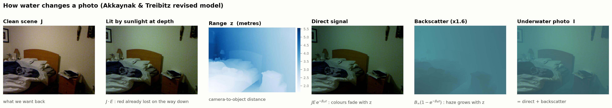

### 3.1 The formula, for one pixel and one colour channel

```
I = J · E · e^(−β_D · z)   +   B∞ · (1 − e^(−β_B · z))
    └── direct signal ──┘      └──── backscatter ────┘
```

| Symbol | Plain meaning | Units |
|---|---|---|
| **I** | The underwater photo (what the camera records) | 0–1 |
| **J** | The true colours of the scene (what we want back) | 0–1 |
| **z** | Distance from the camera to the object (from the depth map) | metres |
| **E** | Colour of the sunlight that reaches the scene (already blue-green at depth) | 0–1, max channel = 1 |
| **β_D** | **Attenuation:** how fast the object's light fades with distance | per metre |
| **B∞** | Colour of the water far away (the "veiling light") | 0–1 |
| **β_B** | **Backscatter:** how fast the haze builds up with distance | per metre |

Everything is done **per colour channel** (R, G, B), so the network predicts 4 quantities × 3 colours
= **12 numbers**.

### 3.2 The same thing in matrix form (all three colours at once)

For one pixel at distance z, each colour has its own equation. Written with matrices, all the matrices
are **diagonal**, which says that the colours do not mix: red light only affects red, and so on.

$$
\underbrace{\begin{bmatrix} I_R \\ I_G \\ I_B \end{bmatrix}}_{\text{photo}}
=
\underbrace{\begin{bmatrix} e^{-\beta_D^R z} & 0 & 0 \\ 0 & e^{-\beta_D^G z} & 0 \\ 0 & 0 & e^{-\beta_D^B z} \end{bmatrix}}_{T_D(z):\ \text{fading}}
\underbrace{\begin{bmatrix} E_R & 0 & 0 \\ 0 & E_G & 0 \\ 0 & 0 & E_B \end{bmatrix}}_{\text{sunlight colour}}
\underbrace{\begin{bmatrix} J_R \\ J_G \\ J_B \end{bmatrix}}_{\text{clean scene}}
+
\underbrace{\begin{bmatrix} 1-e^{-\beta_B^R z} & 0 & 0 \\ 0 & 1-e^{-\beta_B^G z} & 0 \\ 0 & 0 & 1-e^{-\beta_B^B z} \end{bmatrix}}_{\text{haze build-up}}
\underbrace{\begin{bmatrix} B_\infty^R \\ B_\infty^G \\ B_\infty^B \end{bmatrix}}_{\text{water colour}}
$$

Short form: **I = T_D(z) · diag(E) · J + (𝟙 − T_B(z)) · B∞**

**Undoing it** (this is what our "physics layer" does):

$$
J = \operatorname{diag}(E)^{-1}\; T_D(z)^{-1}\;\big( I - (\mathbb{1} - T_B(z))\, B_\infty \big)
$$

In words: **subtract the haze, multiply by e^(+β_D z) to undo the fading, divide by the sunlight colour.**
`T_D(z)⁻¹` is easy because it is diagonal: just `e^(+β_D z)` for each colour. We cap that gain at
**50×**, otherwise noise in far, dark pixels gets blown up.

### 3.3 What Akkaynak changed (why it is the "revised" model)

* Older models (e.g. the ones used by UWCNN) used **one β for both terms**.
* Akkaynak & Treibitz (CVPR 2018) showed from the physics of light that **β_D and β_B are different**,
  and they depend on different things:
  * **β_D** depends on the water, **the distance**, **the object's own colour**, the sunlight and the camera.
  * **β_B** depends on the water, the sunlight and the camera, but **not** on the object.
* In their full model, each β is an integral over all wavelengths of light, weighted by the camera's
  colour filters. The simple exponential formula above is the version you get after that integration.

**Our simplification:** we use **one constant β_D and one constant β_B per colour per image**. Sea-thru
lets β_D change with distance (a sum of two exponentials). Adding that is plan step 2.

**Our addition:** the sunlight colour **E**. Without it, the model has nowhere to put "the light was
already blue before it hit the object", and it blames everything on distance (see the magenta failure in §10).

### 3.4 The two coefficients, side by side

| | **β_D (attenuation)** | **β_B (backscatter)** |
|---|---|---|
| Term | `J · E · e^(−β_D z)` | `B∞ · (1 − e^(−β_B z))` |
| Physical cause | Light from the object is absorbed and scattered away on its way to the camera | Sunlight hits particles between camera and object and bounces into the camera |
| Acts by | **Multiplying** (darkens and tints) | **Adding** (a veil on top) |
| At z = 0 | No effect (factor 1) | No haze (0) |
| Far away | Object light → 0 | Haze → B∞ (the water colour) |
| What you see | **Colour loss**: red disappears first, so things go blue-green | **Contrast loss**: foggy, washed-out look |
| How to undo | Multiply by `e^(+β_D z)` (a gain) | Subtract |
| Example | Clear ocean (Jerlov I): red 0.22 /m, blue 0.02 /m. At 5 m, 34 % of red is left but 91 % of blue | In our synthetic water, β_B = β_D × (0.5 to 2) |

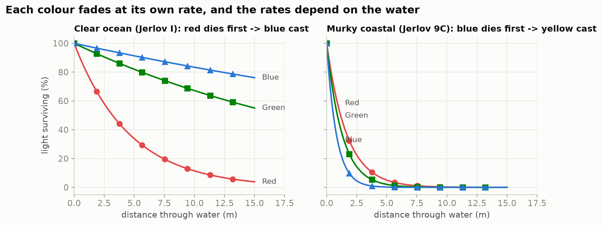

---

## 4. Why we need a depth map

* Distance `z` multiplies every coefficient in the formula. Without it, a **faint red object close up in
  murky water** and a **bright red object far away in clear water** can look identical.
* β is measured **per metre**, so without real distances the coefficients have no meaningful size.
* Where depth comes from: the Sea-thru dataset uses **SfM** (3D reconstruction from many photos). A robot
  could use stereo or sonar. Without any depth sensor, we can **estimate depth from the photo** with
  Depth Anything v2 (DAv2).

**Depth result** (24 real Sea-thru frames vs SfM, `results/depth_eval.json`; AbsRel is the average
relative error, lower is better):

| Depth source | AbsRel |
|---|---|
| DAv2, shape only (scale fixed afterwards) | **0.07** |
| DAv2 metric (indoor model), as is | 0.76 |
| DAv2 metric + **one real range reading** | **0.12** |
| DAv2 metric (outdoor model), as is | 2.59 |

→ **The shape is right but the scale is wrong. A single range reading fixes most of it.**

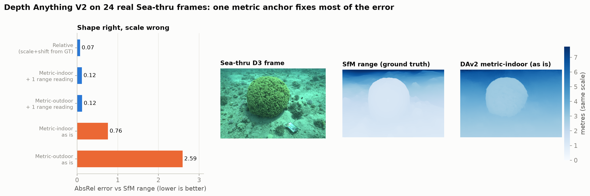

---

## 5. Datasets: what we used and why

Supervised training needs three things: **(1)** water that looks real, **(2)** metric depth, **(3)** the
true answer (coefficients or the clean image).

| Dataset | What it is | Water | Metric depth | True answer | Our use |
|---|---|---|---|---|---|
| **NYU Depth v2** + our synthetic water | Indoor rooms filmed with a Kinect depth camera | simulated | ✓ | ✓ (we chose the water) | **Training** + synthetic test |
| **Sea-thru D1–D5** | Real Red Sea dives with SfM range maps and colour charts | ✓ | ✓ | ✗ | Real test (24 frames, 2 chart frames) |
| **UIEB** | 890 real underwater photos with "preferred" reference images | ✓ | ✗ | ✗ (references are opinions, see below) | Real test (with DAv2 depth) |
| **SQUID** | 57 stereo pairs, 4 dives, colour charts | ✓ | ✓ | ✗ | Not used yet; planned real test |

**Only NYU + synthetic water has all three, so it is the only one we can train on directly.** The real
datasets are for **testing**.

* **NYU details:** the dataset is stored as 157 files ("shards"), each a few hundred video frames from a
  few rooms. We used **19 shards → 2,881 training images** (every 2nd frame, because neighbouring frames are
  near-duplicates). Test: the **official 654 NYU test images** (rooms never seen in training).
  Validation: the last 288 frames (different rooms from training).
* **Image size 240 × 320** (height × width in pixels): half of NYU's 480 × 640. It fits the 4 GB laptop
  GPU and keeps training fast (~15 s per epoch).
* **How UIEB references were made:** the authors ran **12 existing enhancement methods** on each photo and
  **volunteers picked the result they liked best**. So a reference is a *preferred look*, not the true colours.
* **Why not SQUID for training:** it is real water, so **nobody knows the true coefficients or the clean
  image**; it is small (57 pairs); and it is one of the few honest real **test** sets, so we keep it for testing.

---

## 6. How the synthetic water is made (fresh water for every batch)

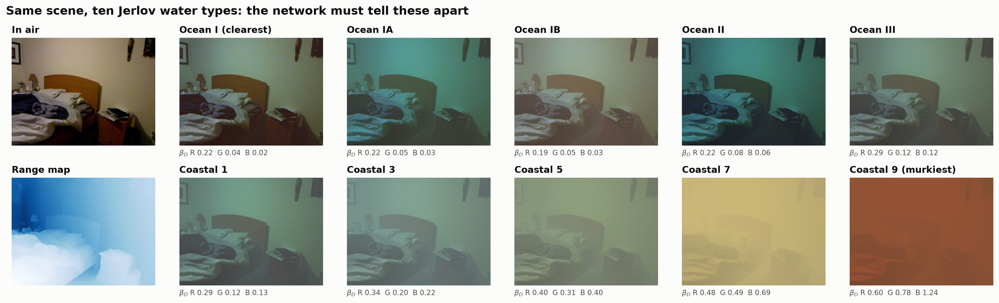

**Jerlov types** are 10 standard ocean water classes, measured by oceanographers: **I, IA, IB, II, III**
(open ocean, clear and blue) and **1C, 3C, 5C, 7C, 9C** (coastal, greener and murkier). Each is published
as "fraction of light left after 1 m", N, per colour. **β_D = −ln(N).**

| Step | What we do | Exact amount |
|---|---|---|
| 1. Scene | Clean NYU photo J + Kinect depth z | Depth randomly stretched **×0.7 to ×2.0** (so scenes aren't all room-sized) |
| 2. Water type | Pick ocean or coastal (50/50), then a random point **between two neighbouring Jerlov types** | Continuous, not just 10 options |
| 3. Turbidity | Make the whole water murkier or clearer | **×0.6 to ×1.6** |
| 4. Per-colour jitter | Each colour's β_D changes a bit on its own | **±15 %** (log-normal, 1 standard deviation) |
| 5. β_B | Backscatter is related to, but not equal to, attenuation | **β_B = β_D × (0.5 to 2)**, per colour |
| 6. Sunlight colour E | White sunlight filtered through the same water on the way down | Scene **0.5 to 12 m** below the surface; normalised so the brightest channel = 1 |
| 7. Water colour B∞ | From the sunlight colour and how much the water scatters vs absorbs; 10 % grey mixed in | Brightness **0.15 to 0.65**, colour jitter ±15 % |
| 8. Apply the formula | `I = J·E·e^(−β_D z) + B∞(1 − e^(−β_B z))` | |
| 9. Exposure | Scene brighter or darker | **×0.7 to ×1.3** |
| 10. Sensor noise | Random Gaussian noise added to every pixel | Standard deviation **0.002 to 0.01** (0.2–1 % of full brightness) |
| 11. Flip | Mirror left-right | 50 % of images |

Every batch gets **new random water**, so the model never sees the same water twice.
**All physics is done in linear RGB.** Normal images (sRGB) are gamma-compressed, which breaks the
add-and-multiply physics, so we convert to linear light first.

---

## 7. The network: BetaNet

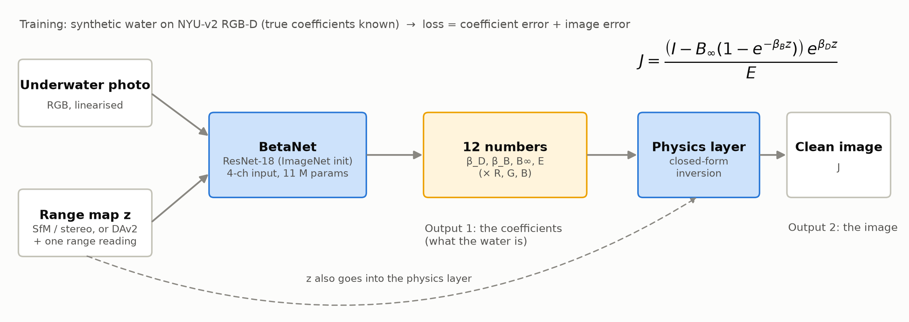

**Input:** a stack of **4 layers, each 240 × 320**: the R, G and B of the underwater photo (square-rooted, a
gentle brightening that ImageNet-trained networks prefer) + the depth map (metres ÷ 10).
That's about 307,000 input numbers.

**Body:** **ResNet-18**, a standard image network, pre-trained on ImageNet (so it already knows edges and
textures). We added a 4th input channel for depth. It shrinks the image step by step to an 8 × 10 grid,
averages it into 512 numbers, then a small head (512 → 256 → 12) outputs **12 numbers**.

**Outputs, kept physically sensible:**
* β_D, β_B: `exp(...)`, so they are always positive (range ≈ 0.0002 to 3 per metre).
* B∞: a sigmoid, so it stays between 0 and 1.
* E: a sigmoid, then divided by its largest channel, so only its **colour** matters (the brightness of the
  light and the brightness of the object cannot be told apart, so we don't ask for it).

**Size:** 11.3 million parameters (backbone 11.2 M, head 0.13 M). **Speed:** 3.2 ms per image.

**Then the physics layer** (§3.2) turns the 12 numbers + photo + depth into the clean image. The
network itself never draws pixels, so it **cannot invent content**; it can only undo water.

---

## 8. The losses (how the network learns)

Total loss = **coefficient loss + image loss** (equal weight, 1 each).

**Coefficient loss** (are the 12 numbers right?):

```
L_coef = |log β̂_D − log β_D| + |log β̂_B − log β_B| + 3 · |B̂∞ − B∞| + |log Ê − log E|
```

* Uses **logs** for β and E, so "10 % off" counts the same for a small β (0.02) and a large one (0.5).
* B∞ is already between 0 and 1, so a plain difference is used (×3 to give it similar weight).

**Image loss** (does the restored image match the clean one?):

```
L_img = Σ t · |Ĵ − J|  /  Σ t ,      where  t = E · e^(−β_D z)   (true values, averaged over colours)
```

* `t` is **how much light actually survives** at that pixel.
* Pixels where almost nothing survives (far away, murky water) **count less**, because nothing can recover them.

**Why both losses? (the identifiability finding)**
We trained with each loss alone (ablation):

| Trained with | Image PSNR | β_D error |
|---|---|---|
| Both (BetaNet) | 20.0 dB | **19 %** |
| Image loss only | **20.7 dB** | 33 % |
| Coefficient loss only | 20.1 dB | 19 % |

**Good-looking images do not mean correct coefficients.** Many wrong combinations of β_D, β_B, B∞, E can
produce a similar image. Only the coefficient labels force the right answer, and that is the whole
reason to train on synthetic water where we know the labels.

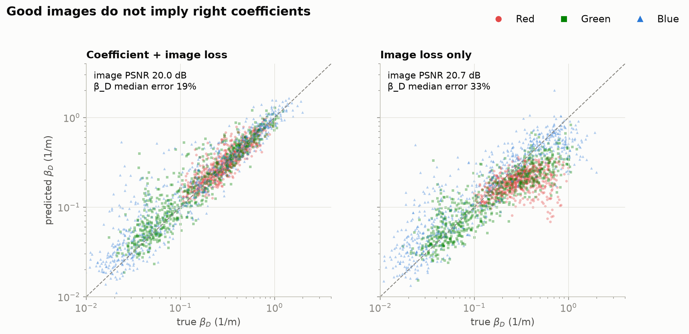

---

## 9. Training

| Setting | Value |
|---|---|
| Batch | 24 images |
| Optimiser | AdamW, learning rate 5×10⁻⁴, weight decay 10⁻⁴ |
| Schedule | **OneCycle**: warm up for 5 % of training, then smoothly decrease to ~0 |
| Epochs | 40 (≈108 gradient steps each, ≈4,300 total) |
| Time | ~15 s per epoch, ~10 min total, laptop RTX 3050 |

* **Gradient step:** take one batch, compute the loss, nudge all 11 M weights a little in the direction
  that lowers it.
* **Epoch:** one pass over all training images.

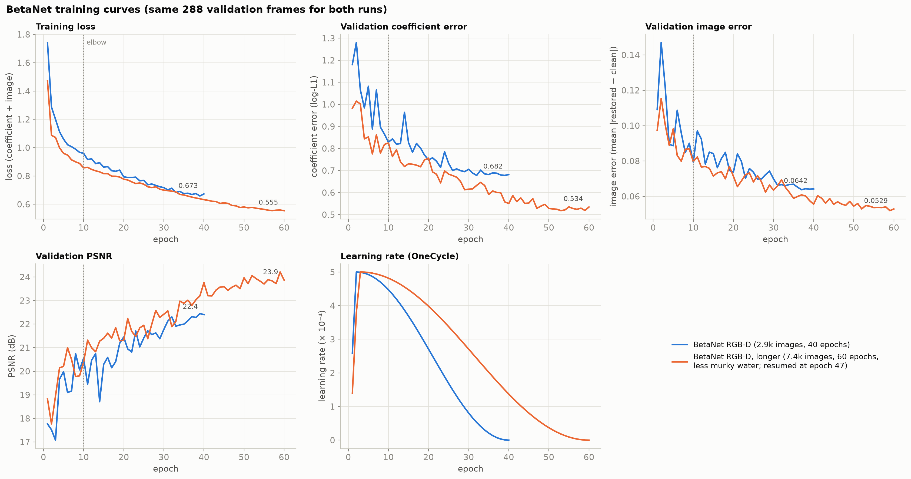

**Reading the curves:** the **elbow is around epoch 5–10** (fast drop, then slow). After that the losses
keep falling steadily. They only flatten at the very end because the **learning rate is forced to zero**
by the schedule. Training loss (0.67) ≈ validation loss (0.68), so there is **no overfitting**.
→ **Past the elbow, but not converged.** More data and more epochs should help (§13).

---

## 10. Baselines and metrics: what each number means

### Baselines (what we compare against)

| Method | What it does | Gives β? |
|---|---|---|
| **Raw** | Do nothing: the underwater photo itself | – |
| **Gray-world** | Scale R, G, B so the image's average colour is grey | ✗ |
| **Sea-thru classical** | Akkaynak's per-image recipe (§2), with true depth | ✓ (slow) |
| **UNet black box** | A network that outputs the clean image directly | ✗ |
| **Oracle** | The physics inversion with the **true** coefficients: the best this formula can do | – |

**Gray-world** in detail:
* It assumes **the average colour of any scene is grey** (an old colour-constancy idea, from Buchsbaum, 1980).
* Formula: `R_new = R × (mean of all channels / mean of R)`, and the same for G and B.
* It **does not set the image to grey**. It only rebalances the three channels with one number each.
* It gives **no coefficients**, **ignores distance** (near and far get the same correction) and
  **cannot remove haze** (haze is added, and gray-world only multiplies).
* It fails on scenes that really are one colour (orange sand, yellow coral): it wrongly pulls them toward grey.

**UNet** in detail: an encoder-decoder network (1.9 M parameters, *smaller* than BetaNet). It shrinks the
image, then grows it back to full size with "skip connections" carrying fine detail across, and outputs
**every pixel of the clean image directly**. It has no physics and no coefficients.

### Metrics

| Metric | What it measures | Better | Needs |
|---|---|---|---|
| **PSNR** (dB) | Pixel-by-pixel closeness to the clean image | higher | the clean image (synthetic only) |
| **SSIM** | Similarity of structure and contrast | higher (max 1) | the clean image |
| **ΔE₀₀** | Colour difference the way a human eye sees it | lower | the clean image |
| **Coefficient error** (% and R²) | How close the predicted β, B∞, E are to the truth | lower % | true coefficients (synthetic only) |
| **Grey-patch angle** (°) | Colour tint left on the chart's grey patches | lower (0° = perfectly grey) | a colour chart in the photo |

* **"Raw PSNR"** = the PSNR of the untouched underwater photo against the clean image. It is the
  "do nothing" starting point. Anything useful must beat it.
* **"Sea-thru PSNR"** = run classical Sea-thru on our synthetic underwater images (with true depth),
  then compare its output with the clean image. It was only run on the first 112 test images, because it is slow.
* **Grey-patch angle:** take the average RGB of the grey patches in the restored image and measure the
  **angle between that colour and pure grey (R = G = B)**. Raw is 29°; Sea-thru's paper reports 8° on
  the same frame.
* **Why grey patches and not red ones?** A grey patch reflects every colour of light equally, so *any*
  camera records it as R = G = B after white balance. We know the correct answer without knowing anything
  about the camera. The correct RGB for a **red** patch depends on that specific camera's colour filters,
  and we don't have that information (or an in-air photo of the chart with the same camera).
* **Why gray-world does so well on the chart:** the chart sits at **one distance**, so one gain per colour
  is exactly the right fix *for that patch*. The grey-patch angle doesn't test what happens at other
  distances, and it doesn't test haze. **Low degrees on a chart ≠ a good restoration of the whole scene.**

**Limits of our metrics (say this, it is a strength):** PSNR, SSIM and ΔE need the clean image, so they
only work on synthetic data, and synthetic data is NYU rooms, which suits the UNet. The grey-patch angle
is real but only covers a few pixels on 2 frames, and measures only tint. Better measures we plan to add:
* **Distance consistency:** the same reef seen from 2 m and 6 m should restore to the same colour.
  No reference needed, and it catches invented colours.
* **Water-type ranking:** turbid water must get a higher β than clear water.
* **Downstream detection (YOLO):** does restoration help a real task?

---

## 11. Results

### 11.1 Synthetic test (654 unseen NYU rooms, random water)

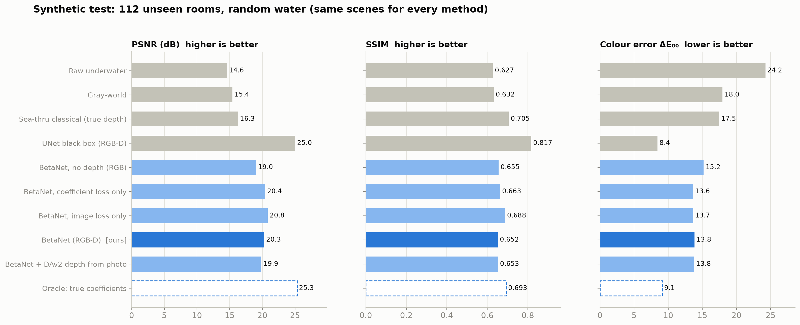

| Method | PSNR ↑ | SSIM ↑ | ΔE₀₀ ↓ |
|---|---|---|---|
| Raw (do nothing) | 14.5 | 0.62 | 24.3 |
| Gray-world | 15.4 | 0.62 | 17.8 |
| Sea-thru classical, true depth (first 112 only) | 16.3 | 0.71 | 17.5 |
| **BetaNet (RGB + depth)** | **20.0** | 0.64 | **14.0** |
| BetaNet + depth estimated from the photo (DAv2) | 19.5 | 0.63 | 14.3 |
| BetaNet, no depth input | 19.3 | 0.65 | 14.9 |
| Oracle (true coefficients) | 25.1 | 0.68 | 9.3 |
| UNet black box | 25.1 | 0.81 | 8.1 |

**Coefficient accuracy** (median error, R / G / B):

| | R | G | B |
|---|---|---|---|
| β_D | 14 % | 20 % | 23 % |
| β_B | 22 % | 23 % | 24 % |
| B∞ | 13 % | 16 % | 17 % |
| E | 8 % | 2 % | 1 % |

R² for β_D: 0.71 / 0.84 / 0.87.

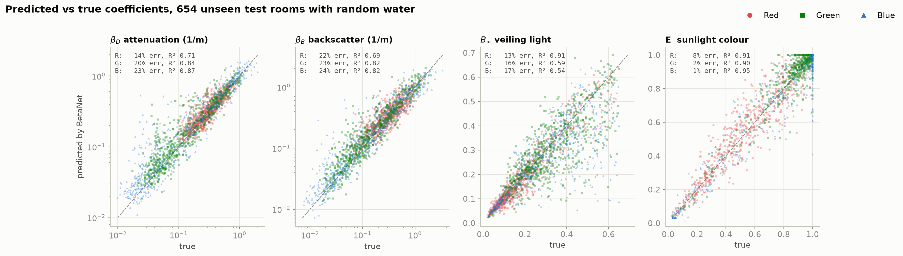

### 11.2 By water type (PSNR on 200 scenes, each in exact Jerlov water)

| Water | Raw | BetaNet | Oracle |
|---|---|---|---|
| I (clearest ocean) | 16.8 | **25.3** | 28.9 |
| III | 14.4 | 22.6 | 28.2 |
| 3C | 13.3 | 21.2 | 27.4 |
| 5C | 12.5 | 18.8 | 25.5 |
| 7C | 11.5 | 14.7 | 19.2 |
| 9C (murkiest) | 11.0 | 10.3 | **10.9** |

In 9C **even the true coefficients fail**: the object's light is gone. But BetaNet's **coefficients are
still right there** (β_D predicted 0.62 / 0.79 / 1.21 vs true 0.60 / 0.78 / 1.24). The water can be
*measured* even when the image can't be *restored*. That is why we keep murky water in training (just less of it).

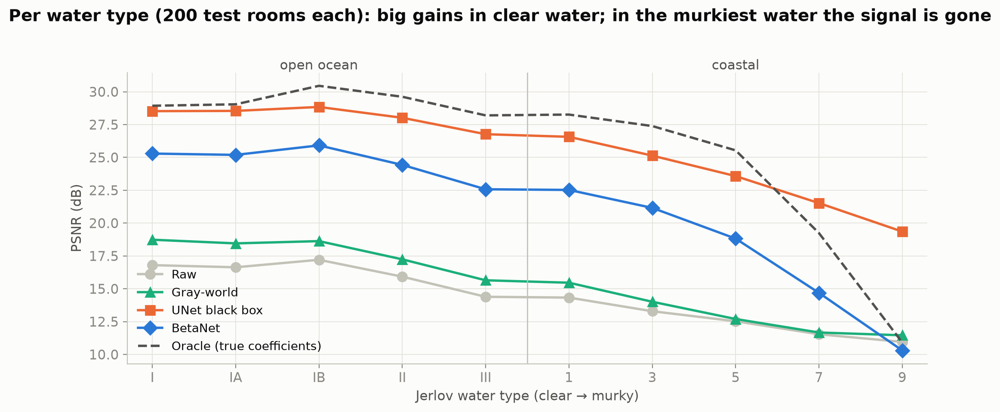

### 11.3 Real photos

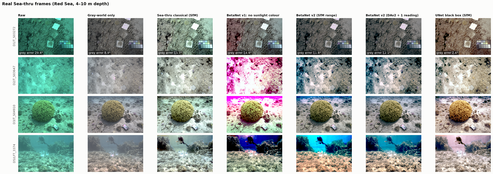

| | Raw | Gray-world | Sea-thru classical | BetaNet + gray-world | UNet |
|---|---|---|---|---|---|
| Grey-patch angle, chart frame 1 | 29.4° | 8.9° | 15.7° | 11.8° | 2.6° |
| Grey-patch angle, chart frame 2 | 29.4° | 8.1° | 16.6° | 11.1° | 3.9° |
| UIEB PSNR (dB) | 16.4 | 17.7 | – | **18.0** | 17.6 |
| UIEB ΔE₀₀ ↓ | 17.5 | **13.8** | – | 13.9 | 15.7 |

* BetaNet beats our run of classical Sea-thru on the chart and is ~120× faster.
* **Honest point:** plain gray-world is better on the 2 chart frames (see §10 for why that metric favours it).
  This gap is the motivation for fine-tuning on real dives (§14).
* **Water-type read-out with no labels:** the turbid dive D4 gets the highest β_D (red 0.38 /m), the clear
  dive D5 the lowest (0.20 /m). The coefficients rank the waters sensibly.

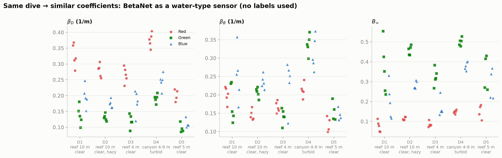
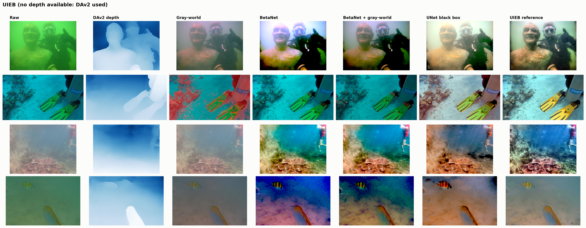

### 11.4 Speed

| | Time per image (240 × 320) |
|---|---|
| **BetaNet** | **3.2 ms** |
| UNet | 10 ms |
| Sea-thru classical | 380 ms (1.2 s at 600 × 400) |

---

## 12. Two different colour failures (don't mix them up)

| | **Magenta (pink-purple, bright)** | **Pink / brown tint** |
|---|---|---|
| Who | **BetaNet v1** (our first version, no sunlight colour E) | **UNet black box** |
| Where | Fig 10, column "BetaNet v1": D2 and D3 | Fig 10, column "UNet": D1 brown, D5 pink water |
| Why | Underwater, the sunlight is already blue-green before it reaches the object. Without E, the only way the model can explain "no red" is distance, so it pushes β_D(red) to its maximum. Undoing that multiplies red by up to 50× → magenta | The UNet learned **what NYU rooms look like** (warm indoor colours) and paints that onto reefs |
| Fix | Add E to the model (v2). Magenta gone; UIEB 15.9 → 18.0 dB | Not fixable by training less (see §15). Needs physics, or training data that looks like the sea |

**Why does the UNet score so well on synthetic data then?**
1. **Per-pixel freedom:** BetaNet must explain the whole image with 12 numbers; the UNet can fix each region separately.
2. **It is trained directly on what PSNR measures** (pixel difference to the clean image).
3. **It recalls NYU rooms**, and the synthetic test is also NYU rooms. Proof: in 9C water the UNet scores
   **19.4 dB, while the true coefficients only reach 10.9 dB**. Physics says that information is gone, so the
   UNet is filling it in from memory. On a real reef that memory is wrong.

This is **not overfitting** (it does just as well on unseen NYU test rooms). It is **domain bias**: it fits
"NYU" rather than "water".

---

## 13. Longer training run (new, 28 Oct evening)

Same network, trained from scratch, with:

| | Original run | Longer run (`beta_rgbd_big`) |
|---|---|---|
| NYU images | 2,881 (19 shards) | **7,428 (49 shards)** |
| Epochs | 40 | **60** (the first try stopped at epoch 48 when the laptop hit 95 °C; resumed from epoch 47 with the same learning-rate schedule) |
| Gradient steps | ~4,300 | ~17,800 |
| Very murky water (mean β_D > 0.8 /m, ≈ 9C) | 4.9 % of training | **2.0 %** (sampled less, not removed) |
| Validation set | 288 frames | the same 288 frames |
| Checkpoint used | best of 40 | best of 60 (epoch 59) |


**Curves:** the longer run is lower on every validation curve (coefficient error 0.68 → 0.52, PSNR 22.4 → ~24 dB)
and is close to flat over the last ~10 epochs, so it is **much nearer convergence**. Training ≈ validation still
(0.55 vs 0.53): no overfitting.

**Synthetic test** (the same 654 unseen rooms and the same water as §11; the original model reproduces its 20.0 dB exactly):

| | PSNR ↑ | SSIM ↑ | ΔE₀₀ ↓ |
|---|---|---|---|
| BetaNet, original | 20.0 | 0.64 | 14.0 |
| **BetaNet, longer run** | **21.2** | **0.66** | **13.5** |

| Median coefficient error (R / G / B) | Original | Longer run |
|---|---|---|
| β_D | 14 / 20 / 23 % | **12 / 16 / 20 %** |
| β_B | 22 / 23 / 24 % | **17 / 17 / 20 %** |
| B∞ | 13 / 16 / 17 % | **11 / 12 / 14 %** |
| E | 8 / 2 / 1 % | 8 / 2 / 2 % |

By water type, the longer run is **+0.8 to +1.4 dB better in every Jerlov type**, including 9C (10.3 → 10.8),
even though it saw less murky water.

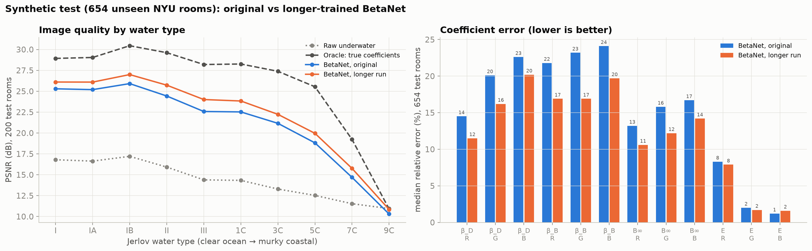

**Real photos:**

| | Original | Longer run | Gray-world |
|---|---|---|---|
| Grey-patch angle, chart 1 / 2 (+ gray-world) | 11.8° / 11.1° | 11.7° / 11.2° | 8.9° / 8.1° |
| UIEB PSNR (+ gray-world) | 18.0 dB | **18.5 dB** | 17.7 dB |
| UIEB ΔE₀₀ (+ gray-world) ↓ | 13.9 | **13.2** | 13.8 |
| β_D red per dive: D1 / D2 / D3 / D4 / D5 | 0.33 / 0.28 / 0.27 / **0.38** / 0.20 | 0.29 / 0.20 / 0.23 / 0.28 / 0.17 | – |

* **UIEB:** the longer run now beats gray-world on both PSNR and colour error.
* **Chart frames:** no change. Better synthetic training does not close the synthetic-to-real gap by itself.
  That supports the plan (realism + real-data fine-tuning).
* **Water ranking:** clear D5 is still the lowest, but turbid D4 is no longer clearly the highest (it ties
  with D1). All the real β values are ~15–25 % lower than before. Say this honestly: with no real labels we
  cannot tell which model's real β is closer to the truth.

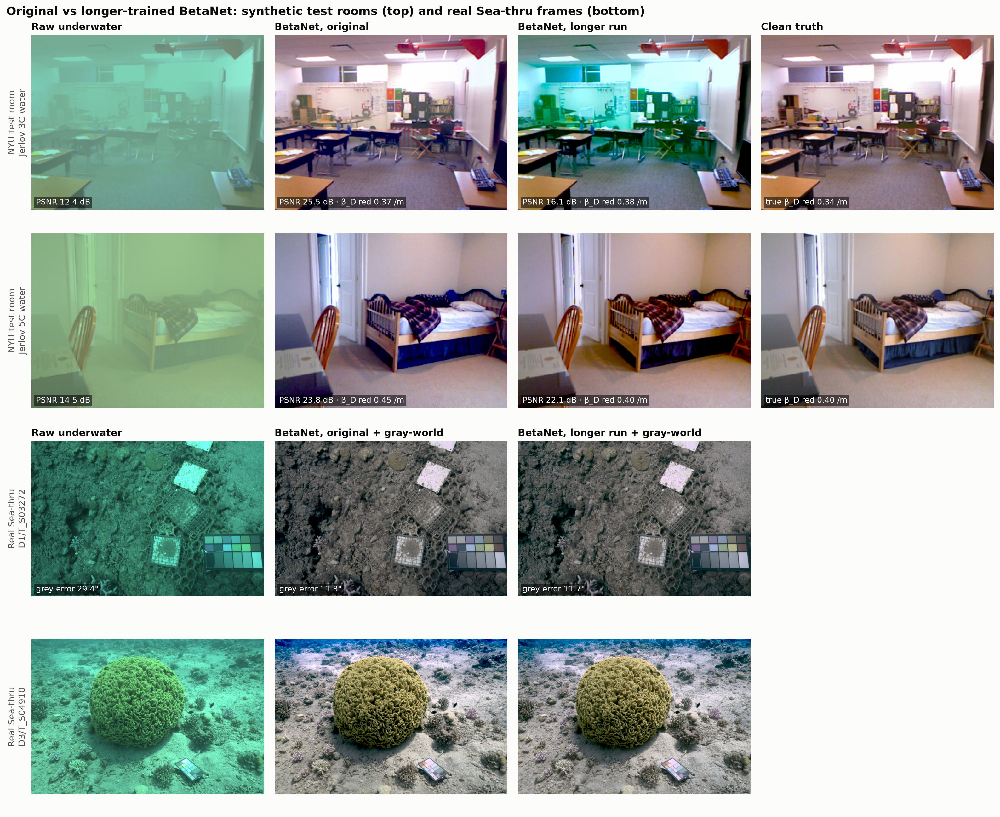

**About the example images:** the 4 example frames were chosen *before* looking at results. The classroom
(top row) happens to be a case where the longer run is **worse** (16.1 vs 25.5 dB, cyan cast). Across 200
rooms in the same water, the longer run is better by more than 3 dB in ~67 rooms and worse by more than 3 dB
in ~20 (median +1.5 dB).

**Why that room turns cyan (a useful lesson about the physics).** We swapped the predicted coefficients for
the true ones one at a time:

| Test (classroom, 3C water) | PSNR | Far wall (> 5 m), restored ÷ true, R / G / B |
|---|---|---|
| All coefficients predicted | 16.1 | **0.33** / 1.41 / 1.35 |
| Only β_D predicted, rest true | 26.2 | 1.31 / 1.19 / 1.33 |
| Only E predicted, rest true | 27.0 | 0.76 / 1.00 / 1.04 |
| Only B∞ predicted, rest true | **15.5** | 0.38 / **1.59** / 1.18 |
| Only β_B predicted, rest true | 17.4 | 0.96 / 0.52 / 0.78 |

* The damage is in the **haze estimate** (B∞, β_B) in the **far half of the room** (8 m deep). β_D alone is fine.
* At 8 m in 3C water, **over 90 % of the red light in the photo is haze**; the object's own red is a tiny
  remainder (`e^(−0.34 × 8)` ≈ 7 % survives). The model's red haze is ~7 % too high, which is **more than the
  whole red signal**, so after subtracting the haze **red is wiped out** (0.33 of the true value).
* Green haze is under-estimated (B∞ green 0.47 vs 0.55), so **leftover green haze** stays in, and then gets
  multiplied by the distance gain `e^(β_D z)` (≈ ×6 at 8 m).
* **No red + extra green and blue = cyan.** "More green" really means "red is missing".
* The original model happened to get the red haze almost exactly right on this image (0.174 vs 0.175), so it
  looked fine. Over 200 rooms the longer run is still better on average.

**Lesson: far away, the photo is almost all haze, so a small error in the haze becomes a big error in the
object.** Every coefficient error is amplified by distance. This is also why a confidence output (plan step 6)
is worth adding: the model should say "low confidence beyond ~6 m in this water".

**UIEB (real photos), original vs longer run:** the longer run is better on 58 of 90 images (mean 18.0 → 18.5 dB).
The fins image (row 3) is bad for both models: they leave the cyan cast and add red speckles. The likely cause
(not yet checked) is the wrong scale of the estimated DAv2 depth, combined with the same far-distance amplification.

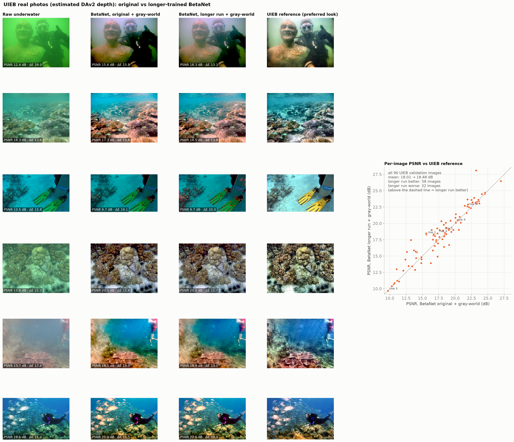

**Sea-thru dives, original vs longer run** (one chart frame per dive, chosen in advance):

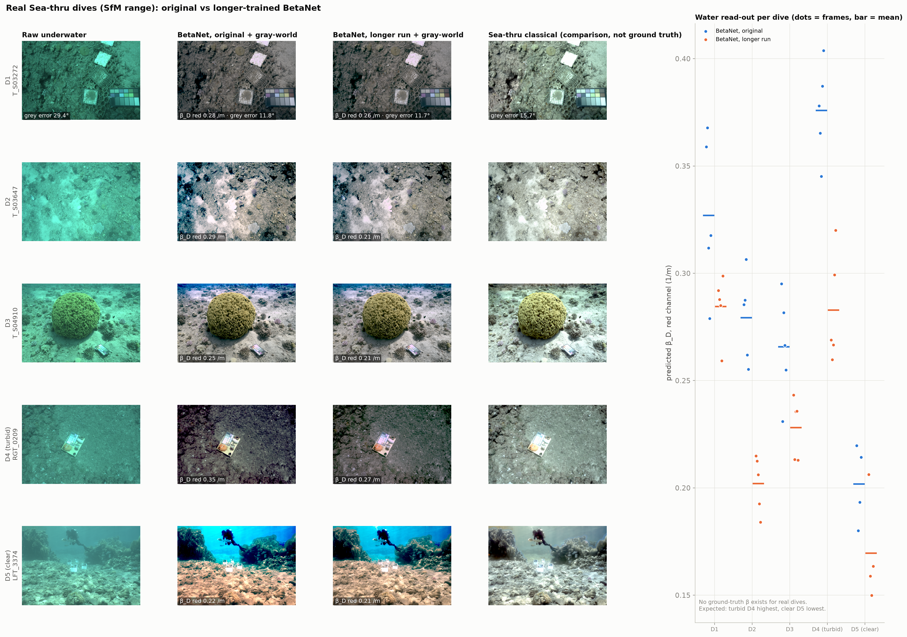

* **Images:** very similar. The longer run is slightly less dark in turbid D4 and slightly less blue in D2's
  shadows. Both models get D5 wrong in the same way (orange sand, electric-blue water); classical Sea-thru is more
  neutral there.
* **Water read-out (right panel):** this got **worse**. The original model clearly picked out turbid D4 (mean β_D
  red 0.38, highest of all dives). The longer run gives D4 about the same as D1 (0.28), and all real β values
  dropped 15–25 %. Clear D5 is still the lowest.
* **Possible cause (not tested):** the longer run saw less very murky water, which may have shifted it toward
  "clearer" answers on real water. To test it, retrain on the same big data with the murky-water reduction switched
  off (`--murky-keep 1.0`).
* **Message:** better synthetic scores did **not** automatically give a better real-water read-out. That is
  the synthetic-to-real gap again, and it is why real-data checks like this one matter.

### Verdict: original vs longer run (paired analysis, `results/old_vs_new_analysis.json`)

We also fine-tuned the longer run with the same recipe as before (no same-dive loss), to see whether
fine-tuning stacks on top of it.

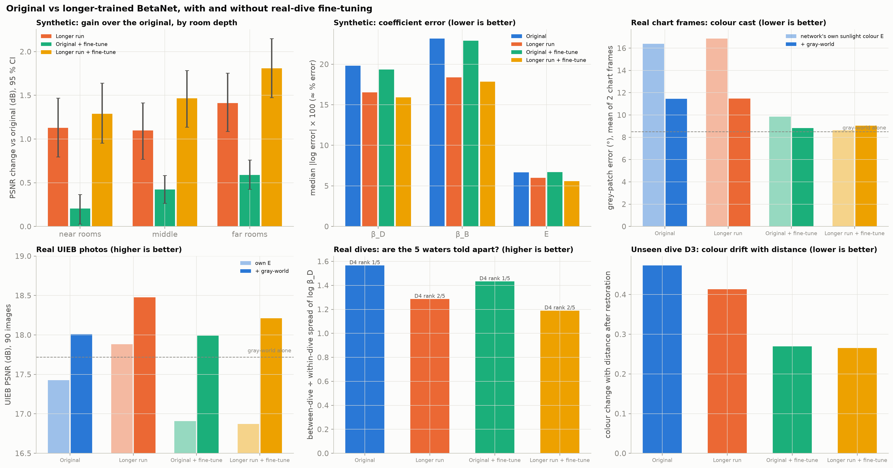

| Question | Original | Longer run | Longer run + fine-tune | Verdict |
|---|---|---|---|---|
| Synthetic PSNR (654 rooms) | 20.0 | 21.2 (**+1.2 dB, 95 % CI 1.0–1.4**, better on 70 % of rooms) | 21.5 | Longer run clearly better |
| β_D / β_B error (median) | 20 / 23 % | **17 / 18 %** (significant) | 16 / 18 % | Longer run clearly better |
| Far rooms (≥ 6 m) | – | **+1.4 dB** (the biggest gain) | +1.8 dB | The cyan classroom was an outlier, not a pattern |
| UIEB + gray-world (90 photos) | 18.0 | **18.5** (+0.47, CI 0.22–0.72) | 18.2 | Longer run better |
| Chart, own sunlight colour | 16.4° | 16.9° | **8.6°** | Only fine-tuning fixes real colour |
| Chart, + gray-world | 11.4° | 11.5° | 9.0° | Same |
| Dive separation (higher = waters told apart) | **1.57** (D4 1st) | 1.29 (D4 2nd) | 1.19 (D4 2nd) | **Longer run is worse** |
| Colour drift with distance, unseen dive D3 | 0.47 | 0.41 | **0.27** | Fine-tuning helps most |
| Validation coefficient error, slope over last 10 epochs | still falling | **flat** | – | Longer run has converged |

* **Is it done training?** Yes, for this data. Its validation error was flat over the last 10 epochs and training
  ≈ validation. More epochs won't help. What would help is **more varied, more realistic data** (outdoor scenes,
  blur, marine snow), not more of the same rooms.
* **Use it?** It is better at the actual task (coefficients) and on synthetic and UIEB data, with tight confidence
  intervals. It is worse at telling real dives apart, which we must explain (test: retrain without the
  murky-water reduction). **Going forward it becomes the base model. For tomorrow, keep the original for the method
  and results slides** (every figure is built on it) **and show this as one "training longer" slide.**
* **Can fine-tuning improve it?** Yes for colour: the real chart error halves (16.9° → 8.6°, as good as gray-world
  without needing it), and colour drift on the unseen dive drops by a third, without hurting synthetic accuracy
  (+0.3 dB). But it **reduces dive separation further** and lowers UIEB without gray-world. That confirms the plan:
  rebalance the losses (less gray-world; a small teacher weight, which kept separation earlier) before fine-tuning
  the new base.

---

## 14. Why fine-tuning comes next (bridge to the plan)

BetaNet is strong on synthetic data, but on real photos it is only about as good as plain gray-world.
This is the **synthetic-to-real gap**:
* the training scenes are **indoor rooms**, not reefs;
* our simulated water has **no forward-scatter blur, no marine snow, no uneven lighting**, and an
  idealised camera.

Real dives have **no coefficient labels**, but they do have **depth**. So we can train on them with
**physics-based, label-free losses** ("the darkest pixels at each distance are pure haze", "restored
colour must not change with distance"), while still mixing in synthetic batches to keep the β units
correct. A first attempt exists; its losses need rebalancing (table at the end).

### The plan (fig 13)

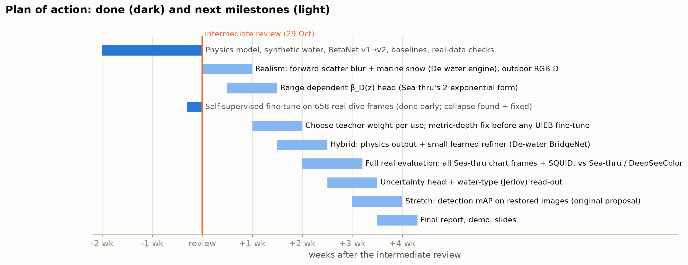

1. **More realistic synthetic water:** forward-scatter blur, marine snow; outdoor / natural RGB-D (DIODE, Hypersim).
2. **Distance-dependent β_D(z)** (Sea-thru's two-exponential form).
3. **Fine-tuning on real dives** with rebalanced label-free losses (less gray-world, no same-dive loss).
4. **Hybrid:** BetaNet physics + a small residual network for the leftovers: black-box quality, still interpretable.
5. **Better real evaluation:** distance consistency, all chart frames at full resolution, SQUID.
6. **Confidence output:** a small head that predicts how wrong each coefficient probably is (trained on synthetic data,
   where the error is known). Stretch goal: YOLO detection on restored images (the original proposal).
7. **Train longer on all of NYU** and a capacity check (ResNet-34 vs ResNet-18).

---

## 15. Questions from our discussions (likely in Q&A)

**Q: What does the network output: the coefficients or the image?**
The **12 coefficients**. The clean image is computed from them by the physics formula. That is what makes
it interpretable, and it means the network cannot invent content.

**Q: Why do we need a depth map at all?**
Water's effect depends on distance. Without it, near-murky and far-clear look the same, and β has no units.
Without a depth sensor, estimated depth + one range reading works (AbsRel 0.12).

**Q: Why train on indoor rooms?**
It is the only data with real metric depth **and** a known answer. We add the water ourselves, so we know
the coefficients exactly. Real underwater datasets lack the answer (Sea-thru, SQUID) or depth (UIEB).

**Q: Why not just use the UNet? It scores best.**
It gives no coefficients (not the task), and it invents colours from its training rooms (pink water on
real dives, 19.4 dB in water where physics allows 10.9). BetaNet can only undo water.

**Q: Is the UNet overtrained? Would fewer epochs help?**
No. It does just as well on unseen NYU rooms, so it is not overfitting. It has learned "what NYU looks like",
and that is a **data/domain** problem. Fewer epochs would make it worse everywhere. Fixes: physics
constraints (our approach) or sea-like training scenes.

**Q: Gray-world beats you on the chart. Why bother?**
Gray-world gives no coefficients, ignores distance and can't remove haze. The chart is at one distance, so a
single colour gain is exactly right for it; the metric doesn't test the rest of the scene. We still
take it seriously: it is why real-data fine-tuning is next.

**Q: Why only measure the grey patches?**
Grey is the only colour whose correct camera RGB we know (R = G = B). The correct RGB for red depends on the
camera's colour filters, which we don't have.

**Q: Has the model converged? Is it big enough?**
The original run was past the elbow but not converged (the loss was still falling when the learning rate
hit zero). A longer run on 2.6× more data and 60 epochs gave 21.2 dB (was 20.0) and lower coefficient
errors everywhere, and its curves are nearly flat at the end (§13). Size: training loss ≈ validation loss, so
no memorising; the loss hadn't hit a floor, so capacity isn't the limit yet. The proper test is ResNet-34.
The bigger limit is the output: 12 numbers = one water and one light for the whole image.

**Q: Why not remove the murkiest water from training?**
Its coefficients are still learnable (β_D in 9C is predicted almost exactly), and the model must recognise
murky water when it sees it. The image loss already ignores unrecoverable pixels. We now sample it less (2 %).

**Q: How is this different from Sea-thru?**
Same physics, same coefficients. Sea-thru solves an optimisation for every image (~0.4 s, needs good
depth). We learned to predict them once from many waters: 3.2 ms per image.

**Q: What does "raw PSNR" mean?**
The untouched underwater photo compared with the clean image: the "do nothing" starting point.

---

## Appendix: fine-tuning on real dives (Part 2 of the talk: what we tried and what went wrong)

**Idea:** keep training on 552 real Sea-thru frames (dives D1, D2, D4, D5; dive D3 held out completely),
with **label-free physics losses** plus a synthetic batch every step to keep the units.

| Loss | What it asks |
|---|---|
| synth (anchor) | Normal supervised loss on synthetic NYU water (keeps β in real units) |
| dark | The darkest 1 % of pixels at each distance should be pure haze (Sea-thru's idea) |
| range | Restored colour must not change with distance |
| gray | Image average, after dividing by E, should be grey (gray-world) |
| dive | All frames from one dive should have the same water |
| teacher | Stay close to the starting model's coefficients |

| Experiment | What happened | What went wrong / lesson |
|---|---|---|
| All losses (v1) | Chart error 11.8° → 10.0°, but every dive got the **same water** (spread 0.24 → 0.05) | **Collapse:** the same-dive loss is easiest to satisfy by giving everything one "average water". Images still look fine, so only the spread check caught it |
| v1 without the synthetic anchor | β_D error on synthetic jumped 19 % → **70 %** | Without labelled data the coefficients **lose their units** |
| No same-dive loss (selected) | Chart 9.4° (9.7° with no gray-world at all), colour drift with distance halved (0.47 → 0.27) | Colour improved, but images became **flat and hazy**, and open water washed out white. The **gray loss** pulls colourful scenes toward grey |
| + teacher 0.1 / 0.3 | Keeps the per-dive water read-out; best UIEB (18.3 dB) | A dial between "best colour" and "keeps the water read-out" |
| + UIEB physics losses | UIEB got **worse** (17.6 → 16.0 dB) | UIEB has no real depth; estimated depth has the wrong scale, so distance-based losses learn from wrong distances |
| + UIEB reference loss | Still worse than without UIEB (17.2 dB) | References are a preferred *look*, not physics |

**Takeaways for the next round:** drop the same-dive loss; **lower the gray-world weight**; depend more on
the dark and range losses; only use UIEB once its depth scale is fixed; check coefficient spread, not just images.

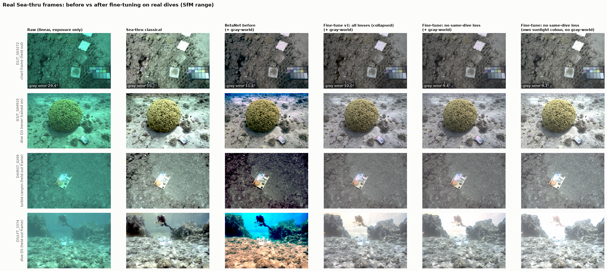
