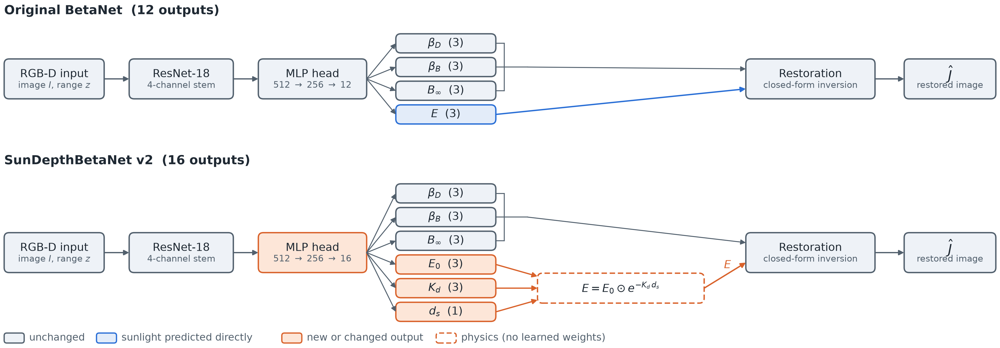

# SunDepthBetaNet v2 (16 outputs): summary

**Question:** does predicting the three physical quantities behind the sunlight colour (surface daylight E0,
diffuse attenuation K_d and depth below the surface d_s) give a more physically interpretable and generalisable
underwater restoration model than predicting the sunlight colour E directly?

**Short answer:**

- **Interpretability.** v2 is far better than v1. v1 is the 10-output model with K_d = 0.8 β_D and a white sun.
  Compared with v1, v2 has:
  - +0.27 dB PSNR and −1.18 CIEDE2000 on the synthetic test;
  - a sunlight colour error of 3.9° instead of 9.4°;
  - more accurate K_d, E0 and depth.
- **Image quality.** v2 matches BetaNet (12 outputs) on the sunlight colour: 3.92° vs 4.05°. Its images are slightly
  worse, −0.25 dB PSNR [−0.40, −0.10]; the CIEDE2000 difference, +0.21 [−0.02, +0.45], is not significant. The gap
  comes from v2's slightly worse backscatter estimates, not from its sunlight.
- **Generalisation to real photos.** Not improved. On UIEB with its own sunlight, v2 is between BetaNet and v1.
- **Separability.** E0, K_d and d_s are only partly separable from one image. Each is learned well enough to
  assemble the right E, but replacing any one of them by its true value makes the image worse. The three
  compensate for each other.

All three models were trained on the same new synthetic water, with the same images, splits, seeds, augmentation,
recipe and checkpoint rule.

Companion documents:
- [LITERATURE_REVIEW_SUNLIGHT_PHYSICS.md](LITERATURE_REVIEW_SUNLIGHT_PHYSICS.md): the physics, its sources and
  presentation talking points.
- [README.md](README.md): folder layout.

The previous experiment (v1 vs BetaNet) is documented in [../sunlight_phy/](../sunlight_phy/README.md).

---

## 1. What changed in the 16-output model



| | BetaNet | SunDepthBetaNet v1 | **SunDepthBetaNet v2** |
|---|---|---|---|
| Outputs | 12 | 10 | **16** |
| β_D, β_B, B∞ | predicted | predicted (same heads) | predicted (same heads) |
| Sunlight | E (3) predicted | d_s (1) predicted; E = exp(−0.8 β_D d_s), E0 = white | **E0 (3), K_d (3), d_s (1)** predicted; **E = E0 ⊙ exp(−K_d d_s)** |
| Backbone, input, restoration | ResNet-18 RGB-D, closed-form inversion | same | same |

The second diagram, [diagram1_betanet_vs_v1](figures/architecture/diagram1_betanet_vs_v1.png), shows BetaNet vs
v1. Both are available as SVG and 300-dpi PNG; the source is [make_diagrams.py](figures/architecture/make_diagrams.py).

Only the last layer of the MLP head changes: 512 → 256 → 16 instead of → 12. Parameters: 11.32 M, against 11.31 M
for BetaNet.

## 2. How E0, K_d and d_s are predicted ([model_v2.py](model_v2.py))

| Output | Activation | Range | Why |
|---|---|---|---|
| β_D, β_B | exp(clamp(o, −7, 2.6) − 1.5) | (2·10⁻⁴, 3) m⁻¹ | unchanged from BetaNet |
| B∞ | sigmoid(o − 1) | (0, 1) | unchanged |
| E0 | exp(clamp(o, −3, 3)), then divided by its largest channel | ratios in [e⁻⁶, 1] | positive. Only its chromaticity matters, because E is normalised by its brightest channel, so the absolute brightness of the sun cannot be recovered (it is confounded with exposure). Two effective degrees of freedom. |
| K_d | exp(ln 10⁻³ + ln 6000 · sigmoid(o)) | (0.001, 6) m⁻¹ | positive and bounded, uniform sensitivity in log space. Covers the labels (0.009–2.4 m⁻¹ in 20 000 training draws). |
| d_s | 15 m · sigmoid(o) | (0, 15) m | positive and bounded; labels are 0.5–12 m (as in v1) |

## 3. The sunlight equation as implemented ([water_v2.py](water_v2.py), `sunlight_v2`)

  log E_c = log E0_c − K_d,c · d_s, then E = exp(log E − max_c log E), floored at 0.03.

- **Log space.** Working in log space and shifting by the per-image maximum before exp() means deep or murky water
  cannot underflow. Tested at K_d = 5.9 m⁻¹ and d_s = 14.9 m.
- **Same convention as BetaNet's E:** brightest channel = 1, floor 0.03. The computed E therefore goes into the
  unchanged `physics.restore` (and `safe_restore` / Day 1b) with no other change.
- **Same function in model and generator.** The network and the synthetic generator use the same function, so the
  true (E0, K_d, d_s) reproduce the true E exactly (tested).

## 4. How the synthetic data generation was modified ([water_v2.py](water_v2.py))

The old generator (`src/physics.py`, line 126) made E = exp(−β_D · d_v · κ) with κ ~ U(0.6, 1.0), E0 white and no
citation. The new one:

- **E0: CIE daylight.** A point on the CIE daylight locus (Judd et al. 1964; CIE 15:2004) at a colour temperature
  drawn uniformly in mired between 4000 K and 10000 K. It is converted to linear sRGB and white-balanced so that
  6504 K (D65) = [1, 1, 1]. Physically, E0 has one degree of freedom (the CCT).
- **K_d: Jerlov's K_d table.** Jerlov's water types are defined by K_d, measured from downwelling irradiance
  (Akkaynak & Treibitz 2018, Fig. 1c), and the project's table (UWCNN Table I) is that K_d table. Same water body as
  the line of sight: same Jerlov position and turbidity as β_D. On top of that, two physical differences:
  - its own per-channel wideband spread (σ = 0.15, the size of β_D's), because RGB coefficients depend on the
    light spectrum and path (Akkaynak et al. 2017, Eq. 9);
  - the sun angle, 1/μ_w(θ_s), from K_d ∝ (a + b_b)/μ₀ (Gordon 1989; Lee et al. 2005), with θ_s ~ U(0°, 60°).

  Result: K_d/β_D has a median of 1.10 and a 5–95 % range of 0.73–1.67 per channel. It is no longer a fixed multiple.
- **d_s:** U(0.5, 12) m. This is exactly the old generator's d_v draw.
- **Unchanged:** β_D, β_B and the random parts of B∞. The old κ draw is still made and discarded, so with the same
  seed every image keeps the same water and depth (tested for the test, validation, Jerlov and training streams).
  Only the light changes: E, and through it the veiling light B∞ ∝ albedo × E.
- **Saved labels:** β_D, β_B, B∞, E0, K_d, d_s, E, plus the CCT and θ_s.

**Important finding (see the literature review, §3):** the project's line-of-sight β_D comes from the same Jerlov
table, so by origin it is a K_d table used as beam attenuation. This is an inherited approximation (UWCNN);
physically, beam attenuation is 2–5× K_d (Akkaynak & Treibitz 2018). We kept β_D unchanged for comparability with
all earlier experiments; this is a stated limitation.

**Splits:** the same 7140 training rooms. Validation is the last 288 frames (water seed 123); the test set is the
654 NYU test rooms (water seed 2026, noise seed 7); the Jerlov sets are the first 200 test rooms × 10 types (seed 1).

## 5. Training configuration and losses ([train_v2.py](train_v2.py))

**Recipe**, identical for all three models and equal to the `baseline_v1_60ep_bigdata` recipe:

| Setting | Value |
|---|---|
| Epochs, batch size | 60, 24 |
| Optimiser | AdamW, lr 5·10⁻⁴, weight decay 10⁻⁴ |
| Schedule | one-cycle (5 % warm-up) |
| Precision, clipping | bf16 autocast, gradient clip 1 |
| Water sampling | murky_keep 0.4 |
| Initialisation | ImageNet |
| Checkpoint | best validation score `val_coef + 10·val_img_l1` (the same 4-term `coef_loss` for every model) |

**Results of training:**

- best epoch 58 for all three models: the validation score was still improving, so no early stopping was needed or
  used;
- epoch time ≈ 20 s on the RTX 5060 Laptop when alone, ≈ 32 s when two runs shared the GPU. The v2 run and the
  baseline retrain ran simultaneously because my process watcher misfired. Each run's data stream comes from its own
  seeded generator, so this does not affect results.

**Loss of v2** (all weights 1, untuned, the same weight v1 used for its depth term):

  L = L_optical + L_E0 + L_Kd + L_ds + L_image + L_E

| Term | Definition |
|---|---|
| L_optical | \|log β̂_D − log β_D\| + \|log β̂_B − log β_B\| + 3 \|B̂∞ − B∞\| (the existing `coef_loss` without E) |
| L_E0 | \|r − mean_c r\|, r = log Ê0 − log E0: chromaticity only, invariant to E0's scale (tested) |
| L_Kd, L_ds | log-L1 |
| L_image | the existing transmission-weighted L1 (`train.img_loss`) |
| L_E | log-L1 of the computed E (the existing `coef_loss` E term) |

**Baseline and v1** were retrained on the v2 water with their own unchanged code
([train_existing_v2data.py](train_existing_v2data.py) only swaps the water generator). This was your decision
(4 Nov), for a fair comparison. The old-water checkpoints are reported as a labelled reference only.

## 6. Results

### 6.1 Three-model comparison (synthetic test, 654 scenes; all trained on the v2 water)

| | BetaNet (12) | v1 (10) | **v2 (16)** | true coefficients |
|---|---|---|---|---|
| PSNR [dB] ↑ | **20.41** | 19.89 | 20.16 | 23.69 |
| SSIM ↑ | 0.627 | **0.629** | 0.621 | 0.653 |
| CIEDE2000 ↓ | **13.76** | 15.15 | 13.98 | 10.55 |
| sunlight E colour error [°] ↓ | 4.05 | 9.38 | **3.92** | 0 |
| E0 colour error [°] ↓ | n/a | 9.07 (white) | **5.57** | |
| K_d median rel. error R/G/B [%] ↓ | n/a | 27.5 / 27.9 / 27.0 (0.8 β̂_D) | **15.7 / 20.4 / 25.0** | |
| depth d_s MAE / RMSE [m] ↓ | n/a | 1.93 / 2.52 | **1.78 / 2.34** | |
| depth R² / Pearson r | n/a | 0.36 / 0.69 | **0.45** / 0.69 | |
| β_D median rel. error R/G/B [%] | 13.3 / 17.6 / 21.7 | 13.0 / 17.1 / 21.8 | 13.9 / 17.8 / 22.6 | |
| β_B median rel. error R/G/B [%] | **15.6 / 17.6 / 19.8** | 15.3 / 18.0 / 21.0 | 18.2 / 19.0 / 20.6 | |
| B∞ median rel. error R/G/B [%] | **9.6 / 12.1 / 15.2** | 10.0 / 12.4 / 15.4 | 10.9 / 12.3 / 16.7 | |
| latency, network only [ms] | 1.21 | 1.50* | 1.21 | |

\*Latency differences are within the measurement noise. Network + restore measured 1.22 / 1.25 / 1.46 ms, and the
ordering changes between the "network" and "network + restore" timings. All three models have the same backbone.

**Paired over the same 654 scenes** (95 % bootstrap interval over scenes):

| | ΔPSNR [dB] | ΔCIEDE2000 | ΔSSIM |
|---|---|---|---|
| v2 − BetaNet | −0.25 [−0.40, −0.10] | +0.21 [−0.02, +0.45] | −0.006 [−0.009, −0.003] |
| v2 − v1 | **+0.27 [+0.10, +0.46]** | **−1.18 [−1.48, −0.89]** | −0.008 |
| v1 − BetaNet | −0.53 [−0.71, −0.34] | +1.39 [+1.08, +1.71] | +0.002 |

Figures:
- [3m_image_quality](three_model_comparisons/3m_image_quality.png), [3m_physical_parameters](three_model_comparisons/3m_physical_parameters.png);
- [3m_jerlov](three_model_comparisons/3m_jerlov.png), [3m_depth_bins](three_model_comparisons/3m_depth_bins.png);
- [3m_attribution](three_model_comparisons/3m_attribution.png);
- galleries [depth × turbidity](qualitative_images/gallery_3m_depth_turbidity.png) and [Jerlov types](qualitative_images/gallery_3m_jerlov_types.png).

Table: [three_model_table.md](three_model_comparisons/three_model_table.md).

**By Jerlov water type** (200 rooms each):
- **v2 vs BetaNet:** v2 is lower by 0.19–0.45 dB in nine types, and higher by 0.10 dB in 9C.
- **v2 vs v1:** v2 is higher by +0.81 to +1.24 dB in clear ocean water (I–II) and +0.2 to +0.6 dB in III–5C. It is
  lower in 7C (−0.36) and 9C (−0.08), where almost no light survives and every model is near the raw image.

**By depth:** v2's sunlight error stays flat at 3.7–4.3° from 0.5 to 12 m. v1's rises from 8.2° to 11.3°.

### 6.2 BetaNet vs v2 (separate comparison)

- **Numbers:** [baseline_vs_16_table.md](baseline_vs_16_comparisons/baseline_vs_16_table.md).
- **Image quality and paired differences:** [b16_image_quality](baseline_vs_16_comparisons/b16_image_quality.png),
  [b16_paired](baseline_vs_16_comparisons/b16_paired.png).
- **By water type and depth:** [b16_by_condition](baseline_vs_16_comparisons/b16_by_condition.png). v2 is lower in
  every depth interval (−0.17 to −0.37 dB). The 95 % CIs reach 0 at 0.5–3 m, cross it at 3–6 m and 9–12 m, and stay
  just below it at 6–9 m ([−0.57, −0.01]).
- **Real photos:** [b16_real](baseline_vs_16_comparisons/b16_real.png).
- **Galleries:** [synthetic](qualitative_images/gallery_b16.png) and [UIEB](qualitative_images/gallery_uieb_b16.png).

**Verdict: v2 does not improve on BetaNet's restoration.**
- Its sunlight is as good (3.92° vs 4.05°).
- It loses 0.25 dB PSNR, and about the same amount, 0.28 dB, remains when both models are given the true E
  (20.42 vs 20.70). So the gap is in the water coefficients: β_B's median error is 0.8–2.6 points worse and
  B∞'s 0.2–1.5 points worse.
  As in the v1 experiment, more output terms change what the shared layers learn.
- Run-to-run spread of this recipe (measured in the v1 experiment): ≈ 0.2–0.3 dB, one seed per model. The gap is at
  that level.

### 6.3 Where image quality is lost ([3m_attribution](three_model_comparisons/3m_attribution.png))

| Variant | PSNR [dB] |
|---|---|
| v2, own sunlight | 20.16 |
| v2 + true E0 | 20.01 |
| v2 + true K_d | 19.45 |
| v2 + true d_s | 19.43 |
| v2 + true E | 20.42 |
| BetaNet, own E | 20.41 |
| BetaNet + true E | 20.70 |
| true coefficients with v1's sunlight model (K_d = 0.8 β_D, white sun) | **20.48** |
| true coefficients | 23.69 |

- **v1's fixed rule is now a hard ceiling.** On the v2 water it loses 3.2 dB even with every coefficient perfect.
  v2's formulation contains the true sunlight, so it has no such ceiling.
- **v2's three quantities compensate each other.** Replacing one by the truth breaks the balance and costs 0.15–0.73
  dB; replacing their product E gains 0.26 dB. Two pieces of evidence:
  - **[depth_meaning](figures/depth_meaning.png) b:** an over-estimated K_d goes with an under-estimated depth
    (Spearman −0.33). E only constrains the optical depth K_d·d_s (panel a).
  - **[v2_error_vs_image](results_16_output/v2_error_vs_image.png):** the larger the depth error, the more inserting
    the true depth hurts (Spearman −0.39). The K_d error barely relates to the image cost (ρ = −0.08).

### 6.4 The 16-output model on its own (results_16_output/)

- **K_d** ([v2_kd_scatter](results_16_output/v2_kd_scatter.png)): log-R² of 0.72 / 0.86 / 0.88 (R / G / B), against
  0.34 / 0.84 / 0.88 for v1's implied 0.8 β̂_D. v1 is biased low in every channel; v2 is roughly unbiased, but
  over-estimates the smallest red K_d.
- **E0** ([v2_e0](results_16_output/v2_e0.png)): R² 0.43 and Spearman 0.66 on the red/blue ratio; mean error 5.6°
  vs 9.1° for a white sun.
  - It recovers whether the sun was warm or cool, but compresses the extremes towards the middle.
  - This is expected: E0 enters only through the colour of E, where it competes with K_d·d_s.
- **Depth** ([v2_depth](results_16_output/v2_depth.png)): MAE 1.78 m, R² 0.45 (v1: 1.93 m, 0.36). Shallow scenes are
  relatively worst; relative error falls with depth ([depth_meaning](figures/depth_meaning.png) c).
- **Sunlight** ([v2_sunlight](results_16_output/v2_sunlight.png)): the computed E matches BetaNet's directly
  predicted E channel by channel.
- **Training** ([v2_training_curves](results_16_output/v2_training_curves.png)): smooth, best at epoch 58. K_d and E0
  errors fall in step with the training loss: no overfitting.
- **All three models' individual predictions:** [individual_parameter_scatter](figures/individual_parameter_scatter.png).

### 6.5 Real photos (three_model_comparisons/3m_real, figures/real_*)

**Ground truth on real photos** is limited to two things:
- the UIEB reference images, which are human-chosen enhancements, not measurements;
- the Sea-thru colour chart, a measured grey. Only one chart frame is available, so this is a weak test.

**There is no ground truth for d_s, K_d or E0 on real photos.** Those are shown as unvalidated in
[real_unvalidated_predictions](figures/real_unvalidated_predictions.png).

| UIEB, 90 photos (CIEDE2000 ↓) | own E | gray-world | Day 1b | Sea-thru chart, own E [°] ↓ |
|---|---|---|---|---|
| BetaNet (12), v2 water | **14.02** | **13.80** | **12.67** | 18.4 |
| v1 (10), v2 water | 15.70 | 14.53 | 13.06 | 18.6 |
| v2 (16), v2 water | 14.91 | 14.43 | 12.95 | **15.5** |
| *ref: BetaNet, old water* | *13.70* | *13.29* | *12.49* | *13.4* |
| *ref: v1, old water* | *14.51* | *13.48* | *12.63* | *20.4* |
| raw photo / plain gray-world | 17.51 / 13.79 | | | 29.4 / 8.9 |

**Does estimating E0 help on real photos?** Not in this test:
- On UIEB with its own E, v2 is 0.89 CIEDE2000 worse than BetaNet [+0.13, +1.63] (v2 better on 43 % of photos).
- Training on the v2 water (varied daylight) made the *same* architecture slightly worse on UIEB: BetaNet 13.70 →
  14.02, v1 14.51 → 15.70 ([real_generalisation_training_water](figures/real_generalisation_training_water.png)).
- v2 is the best of the three v2-water models on the single Sea-thru chart (15.5°), but the old-water BetaNet is
  better still (13.4°).
- v2's predicted E0 on real photos lies on the daylight locus it was trained on. The network uses the locus as a
  prior; this says nothing about the real sun.
- Predicted depths: 7.5–11 m for Sea-thru, and 1.0–13.4 m (median 6.1 m) for UIEB. Unvalidated.

## 7. Main findings

1. **The physical formulation works as a model of the sunlight.** v2's computed E is as accurate as BetaNet's
   directly predicted E (3.92° vs 4.05°) and much better than v1's (9.38°). Removing K_d = 0.8 β_D and the white sun
   removes a ceiling that costs 3.2 dB even with perfect coefficients.
2. **It is more interpretable than v1.** K_d, E0 and d_s are each estimated better than v1's implied values, and the
   depth is somewhat more meaningful (R² 0.45 vs 0.36).
3. **The quantities are only partly separable.** E fixes two colour degrees of freedom; E0, K_d and d_s together
   carry more. The network relies on priors (daylight locus, the link of K_d to the visible water) and trades the
   three off against each other. Individually inserting true values worsens the image.
4. **It does not beat BetaNet's restoration** on synthetic data (−0.25 dB, about one run-to-run spread) or real
   photos (UIEB worse; one chart frame better). Varying the daylight in training did not improve real-photo
   generalisation.

## 8. Limitations

- **One training seed per model.** Gaps of ≈ 0.2–0.3 dB are at the level of run-to-run variation.
- **Inherited β_D.** The line-of-sight β_D comes from Jerlov's K_d table. Real beam attenuation is larger (2–5× K_d);
  correcting it would change every earlier experiment.
- **Generator choices:** the CCT range (4000–10000 K), the sun range (0–60°), the K_d spread (σ = 0.15), the
  overhead-sun reading of the Jerlov table, and no coupling between sun angle and CCT. All are stated choices,
  supported but not dictated by the literature.
- **RGB approximation.** E0 ⊙ exp(−K_d d_s) is a wideband version of a spectral product (Akkaynak et al. 2017);
  sRGB camera primaries are assumed.
- **No hyperparameter tuning.** Loss weights are all 1. Tuning on the test set would be unfair, and there was no
  validation sweep.
- **Real-photo validation is weak.** UIEB references are subjective, there is one chart frame, and there is no
  measured depth, K_d or E0.
- **Process note.** v2 and the baseline retrain ran concurrently (a process watcher misfired). Data streams are
  per-run seeded, so the results are unaffected; only the epoch times were longer.

## 9. Reproduce

```bash
bash sunlight_depth_v2/run_all_v2.sh          # tests, 3 trainings (~1 h total on an RTX 5060 Laptop), eval, figures
bash sunlight_depth_v2/run_all_v2.sh eval     # evaluation, figures, diagrams from existing checkpoints
python sunlight_depth_v2/tests_v2.py          # 21 lightweight checks (< 1 min)
```

- Data, venv and model weights: as for `sunlight_phy` (`~/Downloads/oeml_project_files`, linked as `data/`).
- Checkpoints (`runs/*/best.pt`) and per-image arrays (`*.npz`) are git-ignored by repository convention.

## 10. Literature (details and quotes in the literature review)

| Topic | Sources |
|---|---|
| K_d definition and exponential decay | Gordon (1989), *L&O* 34(8) |
| K_d vs IOPs and sun angle | Lee, Du & Arnone (2005), *JGR* 110 C02016; Gordon (1989) |
| β ≠ K_d ("β is 2–5 times greater than K_d"); D65 surface light | Akkaynak & Treibitz (2018), *CVPR* |
| Jerlov types from downwelling irradiance; wideband coefficients | Akkaynak et al. (2017), *CVPR* |
| The project's Jerlov table | Li, Anwar & Porikli (2020), *Pattern Recognition* (UWCNN), from Jerlov (1976) |
| IOPs of Jerlov types | Solonenko & Mobley (2015), *Applied Optics* 54(17) |
| Daylight locus and range | Judd et al. (1964), *JOSA* 54(8); CIE 15:2004; Hernández-Andrés et al. (2001), *JOSA A* 18(6) |
| Surface irradiance model | Gregg & Carder (1990), *L&O* 35(8) |

**K_d = 0.8 β_D** has no literature support: it is the midpoint of the old generator's uncited κ ~ U(0.6, 1.0).
