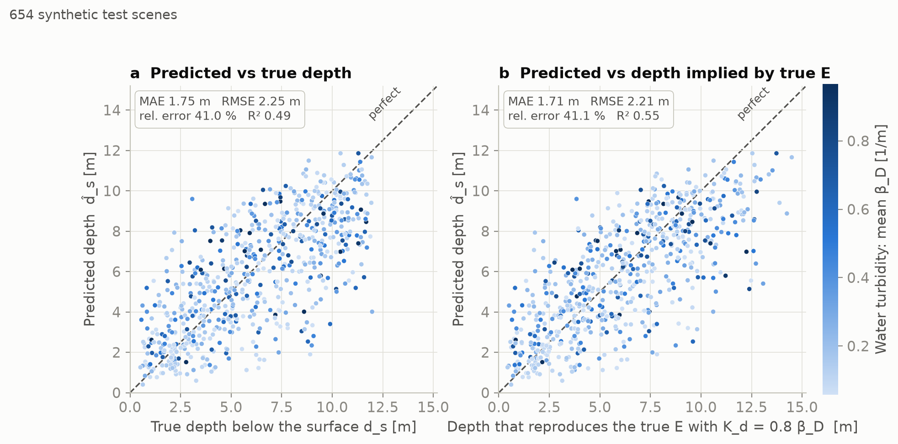
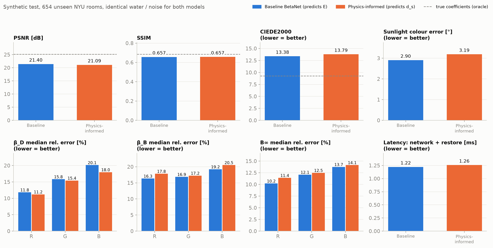
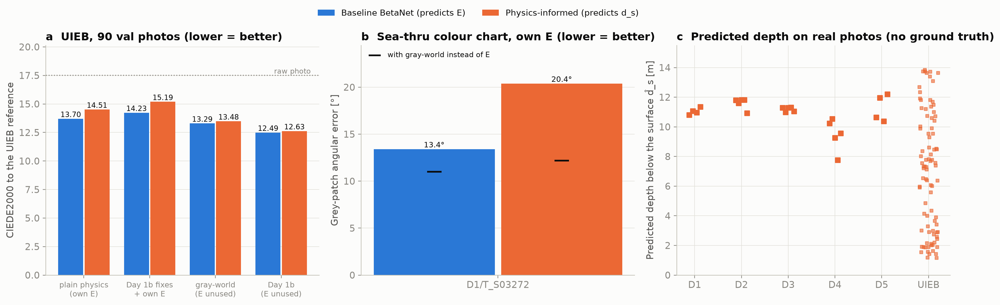

# Results: does predicting the depth below the surface beat predicting the sunlight colour?

**Short answer: no.** The physics-informed model (`sun_v1`) predicts the depth below the surface d_s and computes the
sunlight colour E from it. It restores images slightly *worse* than the baseline BetaNet (`baseline_v1_repro`), which
predicts E directly:

- synthetic test: −0.31 dB PSNR and +0.41 CIEDE2000;
- real UIEB photos: +0.8 CIEDE2000 when each model uses its own E;
- the one Sea-thru colour chart: +7° error.

It does learn depth: correlation 0.73 with the true depth, mean error 1.75 m. That is still far from what the image
allows (0.65 m), and the predicted depth acts more as a knob for fitting E than as a physical depth reading. Both
models were trained once (one seed each) on identical data with an identical recipe.

All numbers come from `results/*.json`, written by `eval_sun.py`, `eval_real_sun.py`, `diagnose_depth.py` and
`repro_check.py`. The figures are in `figures/`.

---

## 0. Setup in one paragraph

Both networks are the same ResNet-18 RGB-D BetaNet with the same β_D, β_B and B∞ heads. Only the sunlight output
differs:

- **Baseline:** 3 numbers, E_R, E_G, E_B.
- **New model:** 1 number, d_s ∈ (0, 15) m. Then E_c = exp(−K_d,c·d_s), normalised to max 1 and floored at 0.03, with
  K_d = 0.8·β̂_D (option A, see [01_design_and_physics.md](01_design_and_physics.md)).

Both were trained for 60 epochs on the same 7140 NYU rooms with the same synthetic water. The training batches are
bit-identical; `verify_rng.py` checks this. The new model gets an extra loss term, |log d̂_s − log d_s|. The
checkpoint with the best validation score is kept, scored by `val_coef + 10·val_img_l1` for both models (epoch 59 for
both).

Evaluation sets:

- **Synthetic test:** 654 unseen NYU rooms. The water (seed 2026) and noise (seed 7) are identical for both models.
- **Jerlov:** 200 rooms × 10 exact water types.
- **UIEB:** 90 validation photos, with Depth-Anything-V2 depth as input.
- **Sea-thru:** 23 frames, of which one (D1/T_S03272) has a usable colour chart.

---

## 1. Is the baseline we retrained the same as the original v1?

**Yes, within run-to-run noise.** The full table is in [03_reproduction_check.md](03_reproduction_check.md).

- **The data are rebuilt exactly.** Every "data check" row (raw image and true-coefficient scores, which involve no
  network) matches the committed numbers to the last digit.
- **The retrained network matches v1 within a few tenths:**
  - synthetic PSNR 21.40 vs 21.21 dB;
  - Jerlov PSNR −0.16 to +0.30 dB;
  - UIEB CIEDE2000 13.70 vs 13.41;
  - median coefficient errors within 0.8 percentage points;
  - best epoch 59 in both runs;
  - the validation curves overlap ([figure 14a](../figures/14_training_curves.png)).
- **One number differs more:** the Sea-thru chart error is 13.4° vs 16.0°. This is one image, so it is noisy.

**What this gives us:** a measured run-to-run spread of about **0.2–0.3 dB** for this recipe (same seed, different
machine and GPU nondeterminism). The old-vs-new differences below have to be read against that spread.

---

## 2. Does the network learn the depth below the surface?

| synthetic test, 654 scenes | network | best possible from E ("floor") |
|---|---|---|
| mean absolute error | **1.75 m** | 0.65 m |
| RMSE | 2.25 m | 0.83 m |
| median absolute error | 1.35 m | 0.51 m |
| mean relative error | 41 % | 11 % |
| bias | −0.36 m | −0.01 m |
| R² / Pearson r | 0.49 / 0.73 | 0.93 / 0.96 |

**What the floor is.** In the generator, E depends only on τ = κ·d_s, and κ ~ U(0.6, 1.0) is never shown to the
network. So even a perfect reading of E pins d_s down only to the interval [τ, τ/0.6]. The floor is the best guess
inside that interval (the geometric mean, clipped to the 0.5–12 m range). No model can beat it on average. The network
is well above it, at 2.7× the floor's error.

- **Error grows with depth.** The median error is 0.9 m at 0.5–3 m and 1.6–1.8 m below 6 m. In murky water it is
  wider (5C and 7C have the widest spread) but not much higher in median; the Jerlov medians are all 1.2–1.5 m
  ([figure 3](../figures/3_depth_by_condition.png)).
- **Error vs sunlight colour.** It is lowest when the sunlight is most red-starved (E_R ≤ 0.25). Those images carry
  the strongest colour signal of depth.
- **The gallery ([figure 4](../figures/4_depth_gallery.png))** shows good depths (errors 0.2–0.6 m) for clearer
  water. In medium and murky rooms the errors are 0–3.7 m, mostly 2–3 m.

**What the predicted depth actually follows** (`diagnose_depth.py`, `results/depth_diagnosis.json`):

| d̂_s compared with … | MAE | Spearman |
|---|---|---|
| true depth d_s | 1.75 m | 0.73 |
| E-equivalent depth κ·d_s/0.8 (gives the true E with the *true* β_D) | 1.71 m | 0.75 |
| **self-consistent depth** (gives the true E with the network's *own* β̂_D) | **1.03 m** | **0.89** |

d̂_s is much closer to "whatever depth makes my own E come out right" than to the true depth. The coefficient loss
rewards a correct E, and E = exp(−0.8·β̂_D·d̂_s). So d̂_s absorbs the network's β_D errors and the unknown κ. The depth
loss pulls the other way, and the result is a compromise.

**The clearest test is to replace d̂_s with the true d_s:** the images get worse, by 0.50 dB on average and in every
κ band (−0.35 to −0.66 dB). The same shows in [figure 10a](../figures/10_error_correlation.png): Spearman ρ = −0.26
between depth error and the PSNR change from inserting the true depth, so the scenes with the largest depth errors are
the ones where the true depth hurts most. The predicted depth is useful to the model because it is *not* the true
depth.

---

## 3. Old vs new: image quality, coefficients, sunlight, speed

| synthetic test, 654 scenes | baseline (predicts E) | new (predicts d_s) | true coefficients |
|---|---|---|---|
| PSNR [dB] ↑ | **21.40** | 21.09 | 25.11 |
| SSIM ↑ | 0.657 | 0.657 | 0.684 |
| CIEDE2000 ↓ | **13.38** | 13.79 | 9.28 |
| sunlight colour error, mean / median [°] ↓ | **2.90** / 2.29 | 3.19 / 2.47 | 0 |
| β_D median rel. error R/G/B [%] | 11.8 / 15.8 / 20.1 | **11.2 / 15.4 / 18.0** | |
| β_B median rel. error R/G/B [%] | **16.3 / 16.9 / 19.2** | 17.8 / 17.2 / 20.5 | |
| B∞ median rel. error R/G/B [%] | **10.2 / 12.1 / 13.7** | 11.4 / 12.5 / 14.1 | |
| E median rel. error R/G/B [%] | 7.1 / 1.7 / 1.3 | 7.2 / 1.9 / 1.1 | |
| latency, network + restore [ms] | 1.22 | 1.26 | |

Latency is the median of 5×50 calls, batch 1, 240×320, bf16, RTX 5060 Laptop.

**Paired over the same 654 scenes ([figure 6](../figures/6_paired_psnr.png)):**

- New − old PSNR is **−0.31 dB**, with a 95 % bootstrap interval of [−0.46, −0.15] over scenes.
- The new model is better on 43 % of scenes.
- CIEDE2000 is +0.41 (interval [+0.09, +0.71]).
- SSIM is equal: +0.0004 (interval [−0.002, +0.003]).

The interval covers only the choice of test scenes, not training randomness. The gap is about the size of the
measured run-to-run spread (section 1). With one seed per model, it is safest to say the new model is **no better
and probably slightly worse**, not that it is significantly worse.

**Per Jerlov water type ([figure 7](../figures/7_jerlov_comparison.png)):**

- The new model is lower in PSNR in 9 of 10 types: −0.11 to −0.48 dB, and +0.02 dB in 5C.
- Its sunlight error is equal or slightly lower in types I–II and higher from type III on. The largest gaps are 5C
  (3.3° vs 2.9°) and 9C (2.8° vs 2.2°).

**By depth ([figure 8](../figures/8_depth_bins_comparison.png)):**

- In shallow water (0.5–3 m) the new model's sunlight error is slightly *lower* (2.8° vs 3.0°).
- Below 6 m it is clearly higher (3.4° vs 2.9°).
- PSNR is lower in every depth bin.

### Where does the gap come from? ([figure 9](../figures/9_illumination_attribution.png))

Each model's own E is swapped for the true E while its other coefficients are kept:

| | own estimate | with the true E | lost to E |
|---|---|---|---|
| baseline | 21.40 | 21.67 | 0.27 dB |
| new | 21.09 | 21.40 | 0.31 dB |

- **The sunlight is not the main cause.** Even with the true E, the new model stays 0.27 dB below the baseline with
  the true E. Most of the gap comes from its slightly worse β_B and B∞ (the table above). Sharing a single depth
  output changes what the shared layers learn; β_D got a little better and the backscatter terms a little worse.
- **Option A has a built-in ceiling.** With *all* coefficients true and E computed from the true depth with
  K_d = 0.8·β_D, PSNR is 24.64 dB instead of 25.11 dB. That is 0.47 dB lost before any network is involved. The cost
  is 1.28 dB for scenes whose hidden κ is 0.6–0.7, and 0.07 dB for κ near 0.8. A fixed κ₀ cannot express every E the
  generator makes.

---

## 4. Real photos (no ground-truth depth)

**UIEB, 90 validation photos** (CIEDE2000 to the UIEB reference, lower is better; raw photo 17.51):

| restoration | baseline | new |
|---|---|---|
| plain physics, own E | **13.70** | 14.51 |
| Day 1b fixes + own E | **14.23** | 15.19 |
| plain physics + gray-world (E unused) | 13.29 | 13.48 |
| Day 1b (the recipe in use; E unused) | **12.49** | 12.63 |

- When the restoration uses each model's own E, the new model is clearly worse: +0.8 to +1.0.
- When E is replaced by gray-world or Day 1b, the two models are within 0.2. That is the β_B / B∞ gap from section 3.
- PSNR shows the same pattern: 18.00 vs 17.60 with own E, 18.98 vs 18.83 with Day 1b.

**Sea-thru colour chart (D1/T_S03272), grey-patch angular error:**

- Own E: baseline 13.4°, new **20.4°**. With gray-world: 11.0° vs 12.2°.
- Why it is worse: the new model's E has to have the same shape as exp(−0.8·β̂_D·d̂). For this water β̂_D,B > β̂_D,G,
  so it is forced to make E_B < E_G: E = (0.23, 1, 0.62), against the baseline's (0.21, 1, 0.74). The baseline can
  choose E freely.
- This is a single frame. D1/T_S03425 has no image in the HuggingFace copy of Sea-thru.

**Predicted depths ([figure 13c](../figures/13_real_results.png)):**

- Sea-thru: 7.8–12.2 m for all 23 frames of the five dives, near the top of the training range (12 m).
- UIEB: 1.2–13.9 m, median 7.3 m.

Without the dive depths we cannot say whether these are right. I asked for the Sea-thru dive-depth table; until it
exists, the real-photo depths are unvalidated. In the UIEB gallery ([figure 12](../figures/12_qualitative_uieb.png))
the shallow-looking snorkelling and reef shots get 1.4–4.0 m and the green diver selfie gets 11.4 m. That is
plausible in ordering but not checked.

---

## 5. Qualitative

- [Figure 11](../figures/11_qualitative_synthetic.png): synthetic restorations next to the ground truth. The two
  models look nearly the same. The visible differences are overall colour casts, not structure. Rows 1 and 6 are where
  the new model's ΔE is 2–5 higher.
- [Figure 12](../figures/12_qualitative_uieb.png): six fixed UIEB photos (indices 0, 15, …, 75, chosen before looking
  at outputs). Again they look nearly the same. Per photo, the new model is better on 2 of the 6 (ΔE 7.7 vs 10.3 and
  18.4 vs 25.0) and worse on 4.

---

## 6. Conclusion

1. **Predicting d_s instead of E does not improve restoration** on synthetic data or real photos. On every image
   metric it is equal or slightly worse: −0.3 dB PSNR synthetic, with a larger gap on real photos when its own E is
   used.
2. **Depth from a single image is learnable but weak:** r 0.73, mean error 1.75 m against a floor of 0.65 m. The
   predicted depth mainly tunes E rather than measuring depth, which is why the true depth makes the images worse.
3. **The structure costs some flexibility.** Tying E's colour shape to β_D through K_d = 0.8·β_D loses 0.47 dB even
   with perfect coefficients. On the real chart it forces a wrong E.
4. **What the experiment does show:** with 10 outputs instead of 12 and a physically readable sunlight term, the
   model stays within about 0.3 dB of the baseline at the same cost (1.26 vs 1.22 ms). Its β_D is slightly more
   accurate, and its sunlight is better in shallow water.

## 7. Limitations (read before quoting the numbers)

- **One training seed per model.** The retrained baseline differs from v1 by up to 0.3 dB; the old-vs-new gap is
  about that size.
- **The depth labels come from the project's own generator** (`src/physics.py`, lines 121–128). In that generator
  K_d = κ·β_D with κ ~ U(0.6, 1), an uncited heuristic, not measured Jerlov K_d. Results about "depth" are therefore
  about *this generator's* depth.
- **E0 (surface sunlight) is assumed white.** This matches the generator but not real sunlight.
- **Option A fixes κ₀ = 0.8.** κ and d_s are not separately identifiable from E (only τ = κ·d_s is), so the floor in
  section 2 is the best any model can do.
- **No real depth ground truth.** The real-photo depths are unvalidated, and there is only one usable colour chart.
- **Settings not tuned.** The depth-loss weight (1.0), the d_s bound (15 m), the detached β_D in K_d and κ₀ were set
  once and not tuned, because tuning on the test set would be unfair. A small sweep on the validation set might close
  part of the gap.

## 8. Possible next steps (not run)

- **Decouple E's shape from β_D:** give K_d its own 3 outputs (13 outputs in total) or learn κ₀. This would remove the
  0.47 dB ceiling but lose the "one number" idea.
- **Train 2–3 more seeds of each model** (~20 min per run) to settle whether the 0.3 dB gap is real.
- **Validate on real photos with known depth,** for example Sea-thru with the dive depths, or any set with dive-computer
  logs.
